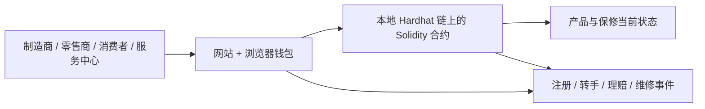

# 方案设计（方案 1 已确认）

依据 `COMP5565 Decentralized Apps Fundamentals and Development.pdf` 的 2026/27 Semester 1 项目说明。课程允许 Ethereum 或 Hyperledger Fabric，要求四类角色、产品溯源、保修申请与处理、真实性和所有权查询、隐私取舍、本地部署，并提交设计报告、代码和演示。

## 三个方案（按推荐程度）

| 顺位 | 方案 | 架构和数据 | 优点 | 代价与适用条件 |
| --- | --- | --- | --- | --- |
| 1 | **本地 Ethereum + Solidity + 网站直连** | Hardhat 本地链；合约保存产品当前状态和保修条款，以事件记录转手、理赔和维修；浏览器钱包签名，前端从合约和事件读取。无独立业务数据库。 | 最少运行组件；最贴合“可运行的合约逻辑”和现场演示；透明溯源容易验证。 | 序列号、钱包地址和转手时间在链上公开；事件查询较慢；需控制存储与 gas。适合课程演示数据。 |
| 2 | **Ethereum + 后端索引与受控资料库** | 合约保留可验证的状态/摘要；后端索引事件并存放仅授权方可见的详细维修资料，前端通过 API 读列表，交易仍由钱包签名。 | 查询体验与隐私更好，可以做丰富可视化。 | 后端同步、权限、数据库和故障处理会分散五人小组的精力；必须说明数据库不是所有权的权威来源。 |
| 3 | **Hyperledger Fabric 联盟链** | 制造商、零售商和服务中心运行组织节点；Chaincode 管理资产和保修，私有数据集合处理敏感细节；前端经网关访问。 | 参与方身份和数据可见范围更可控，无以太坊 gas。 | CA、证书、通道、节点和部署成本最高；现场演示环境更复杂。适合成员已有 Fabric 经验且隐私是首要目标。 |

**小组已选择方案 1**。隐私边界为：仅使用虚构产品和测试钱包，不上链姓名、联系方式、详细维修描述、照片或维修报告；链上序列号与地址仍然可公开关联。课程演示不使用真实消费者资料。

### 线上协作补充（2026-11-17）

前端静态发布到现有公开仓库的 GitHub Pages，线上版本连接 Sepolia 公共测试网；课程要求的本地 Hardhat 部署仍保留。没有新增业务后端或数据库。构建时选择网络，页面显示目标链，不再固定只允许 31337。

测试网合约由管理员通过浏览器钱包部署，私钥不进入网页、源码或 CI。部署后管理员授权组员的制造商、零售商和服务中心地址。合约地址、部署区块和链 ID 是公开连接信息，可通过页面生成的链接分享；不随链接提供自定义 RPC。没有完成合约部署时，线上页面明确显示“未连接合约”，不伪造可用业务数据。静态网站上线不等于测试网合约已部署。

公共 RPC 的历史读取从合约部署区块开始，分段查询事件，避免从测试网创世区块全量扫描。Sepolia 使用测试 ETH，不使用以太坊主网。管理员部署账户和五名组员各自控制的钱包应由小组自行持有。

## 方案 1 的可实现设计

- **身份与权限**：部署者钱包是唯一管理员，可添加或撤销制造商、零售商、服务中心。暂不实现多管理员投票和管理员转移。客户不注册为系统角色，持有产品的钱包就是当前客户。每个受限方法在合约检查调用者，前端隐藏按钮只改善体验。
- **产品**：`productId` 和 `serialNumber` 分别全局唯一；合约同时保存型号、制造商地址、注册时间、当前所有者、保修时长和理赔上限。注册后这些核心资料不可修改。
- **转手**：采用两步转让。当前所有者发起并指定接收地址，接收者确认后才更新所有权。制造商只能转给已授权零售商；零售商只能转给当前未被登记为制造商、零售商或服务中心的消费者地址；消费者只能转给新的消费者。发起和确认两个时点都校验接收者的当前角色；等待期间角色改变导致路径不合法时，确认失败且不改变所有者、保修或旧理赔，仍可拒绝、取消或超时清理。接收地址不能是零地址或当前所有者。每笔转手都有固定截止时间，管理员配置默认超时为 10 分钟；发起时锁定截止时间，后续修改只影响新转让。当前所有者可以取消，接收者可以拒绝，截止时间之后任何人可以清理并记录 `Expired`。
- **保修**：制造商注册时写入保修时长和理赔上限，初始所有者为制造商。零售商向消费者转让并由消费者确认接收时激活保修。保修到期或批准次数达到上限时，不能提交或批准新的理赔。
- **理赔**：同一产品同时最多一个 `Pending` 理赔。申请只保存产品、申请 ID、申请时所有者、固定问题类型、时间和状态，不保存个人资料或维修材料。任意已授权服务中心可以批准或拒绝任意产品的待处理申请。拒绝不消耗次数且可以重新申请；批准时增加次数。已批准申请可以在保修到期后完成。
- **维修与服务中心撤销**：`Approved` 不代表已经维修。服务中心完成后记录 `Repaired`、`Replaced`、`Refunded` 或 `Other`。撤销服务中心后，它不能处理新申请或批准新的理赔，但可以完成自己此前已经批准的 `Approved` 理赔；其他仍授权的服务中心也可以完成已批准理赔。
- **转让与旧理赔**：转让发起但未确认时，原所有者仍是当前所有者，原 `Pending` 理赔仍有效。接收者确认时，若旧申请仍为 `Pending`，则改为 `CancelledByTransfer`；已 `Approved` 的申请保留并继续跟随产品，`Rejected` 和 `Serviced` 历史不变。新所有者可以提交新的申请。
- **查询与数据库设计**：合约存查询所需的当前字段，事件日志是追加的历史账本；公开验证页无需连接钱包，输入产品 ID 和序列号即可读取真实性、制造商、当前所有者、保修状态和所有权历史。注册、转手、理赔和维修等写操作需要钱包签名。课程规模无需服务器数据库。
- **安全与成本**：拒绝重复注册和越权操作；测试到期、次数边界、重放/重复处理、非法转手、超时清理、撤销角色及待处理竞争。转手历史使用事件；理赔详情和 ID 索引仍保存在合约，便于课程规模查询，但全量读取随历史增长，尚无分页。报告需记录关键交易的 gas 实测，不能把当前实现描述为已完成成本优化。
- **可用性**：前端使用 React、Vite、TypeScript、ethers.js；角色入口清楚，交易显示待签名与待确认状态；验证页提供无需钱包的只读访问；支持键盘操作、可读的状态文字和错误说明。网络或钱包不匹配时给出恢复步骤。
- **页内引导**：沿用现有页面样式，以轻量中文提示说明下一步对应的英文按钮；根据已查询产品、转让截止时间和理赔状态更新，不使用遮罩或强制弹窗。引导可定位并聚焦相关字段、预填选中的理赔编号，但不自动发送交易；切换账户时提示在钱包连接网站并核对地址。已批准维修优先于新申请，过期或额度耗尽不推荐提交新理赔。
- **操作反馈**：查询、钱包连接、注册、转让、理赔、部署及授权操作都有可见反馈；输入错误、越权、无效状态和钱包拒绝提供中文原因及恢复步骤。操作区域保留结果，同时提供不遮挡流程的浮动通知。区分等待签名、已提交待确认、确认成功和失败；交易已提交但结果未知时提示查钱包，不把 RPC 刷新失败当成交易失败。前端解码现有合约错误，不更改合约权限或状态机。
- **部署与提交**：合约目录使用 Hardhat + Solidity，网站目录使用 React + Vite。部署脚本在本地链初始化管理员和演示角色；从干净克隆启动本地链、部署合约、启动网站，随后用四类测试钱包演示一次转手和一次理赔。报告须给出准确命令、依赖版本和截图，最终 ZIP 不带 `node_modules`。

## 已冻结的关键参数

- 方案：本地 Hardhat Ethereum + Solidity，网站直连合约，无独立业务数据库。
- 前端：React + Vite + TypeScript + ethers.js。
- 默认转让超时：600 秒（10 分钟）；管理员可修改，修改只影响新发起的转让。
- 保修时长单位：注册交易传入秒数；界面输入的一月固定换算为 30 天（不是自然月），详情显示天数；保修状态综合起止时间与获批次数，页面自动更新时间。
- 问题类型：`Screen`、`Battery`、`Software`、`Other`。
- 服务结果：`Repaired`、`Replaced`、`Refunded`、`Other`。
- 理赔状态：`Pending`、`Rejected`、`Approved`、`Serviced`、`CancelledByTransfer`。

这些规则已经作为合约接口和验收测试的依据；后续若需变更，先同步修改本文件和 [验收矩阵](acceptance.md)。
